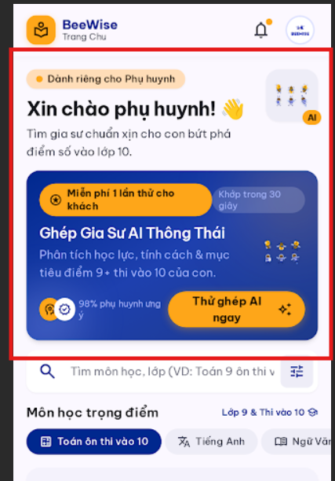
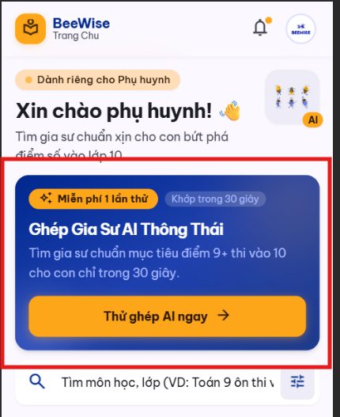
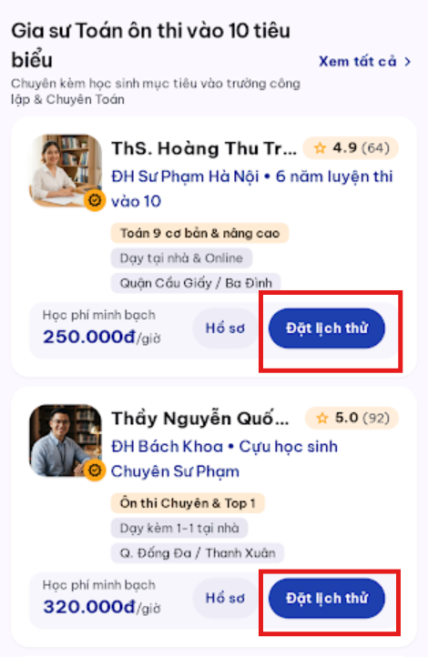
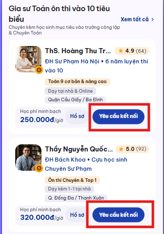

# AI Iteration 01 — Home & Business Flow

## Objective

Giảm nhiễu thông tin trên Home và sửa CTA cho đúng quy trình kết nối.

## Scope and execution order

- **Tool:** Google Stitch
- **Prompt sequence:** UX-01 → UX-02; hai prompt được gửi riêng, theo thứ tự lịch sử Agent Log.
- **Original screens:** Banner AI ở Home (UX-01) và CTA trên card gia sư ở Home (UX-02), theo ảnh Before.

### UX-01 — Home AI banner

**Actual prompt:** [UX-01.txt](../prompts/UX-01.txt)

**Before:**

**After:**

**Evaluation:** CTA “Thử ghép AI ngay” nổi bật hơn và số liệu hài lòng không còn. Banner vẫn cao, còn hai nhãn, tiêu đề, mô tả hai dòng và hình minh họa nên mục tiêu gọn nội dung chưa đạt.

**Final decision:** **Modify further**

### UX-02 — Tutor card CTA

**Actual prompt:** [UX-02.txt](../prompts/UX-02.txt)

**Before:**

**After:**

**Evaluation:** Hai card trong ảnh After đều dùng “Yêu cầu kết nối” thay vì “Đặt lịch thử”, phù hợp với quy trình có tư vấn viên.

**Final decision:** **Accept**

## Reflection

- **What improved:** CTA kết nối đã đổi đúng hành động nghiệp vụ; CTA AI dễ nhận biết hơn.
- **What remains unresolved:** Banner AI vẫn chiếm diện tích lớn và chứa nhiều nội dung; ảnh UX-02 không thể hiện bước đăng nhập hoặc nhóm chat.
- **Next action:** Chạy prompt refinement riêng cho UX-01 để bỏ bớt nhãn, rút mô tả và giảm chiều cao banner. Nếu cần chứng minh toàn luồng UX-02, bổ sung ảnh màn đăng nhập/nhóm chat tương ứng.

> Đây là nhóm báo cáo của hai prompt refinement riêng, không khẳng định chúng được gửi trong cùng một lần chạy.
