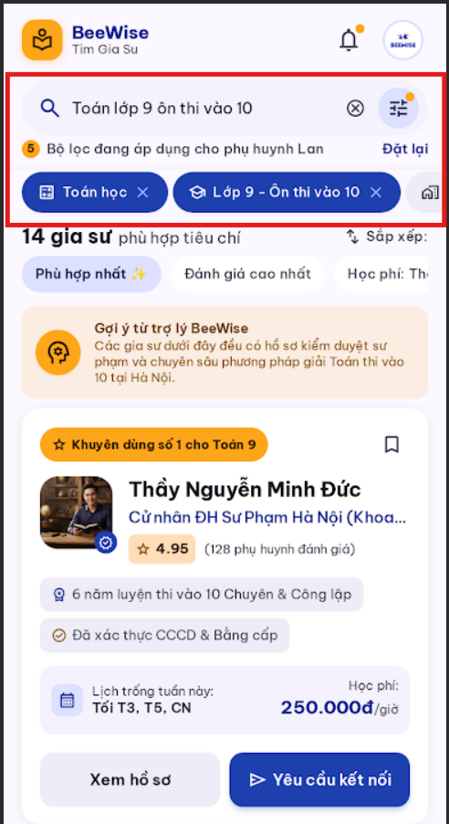
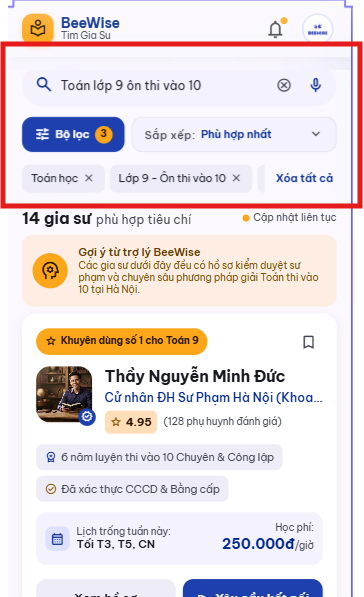
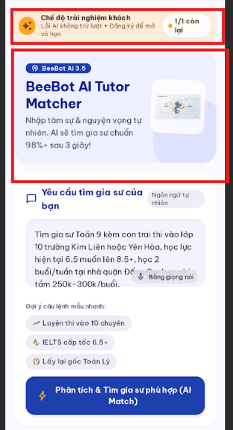
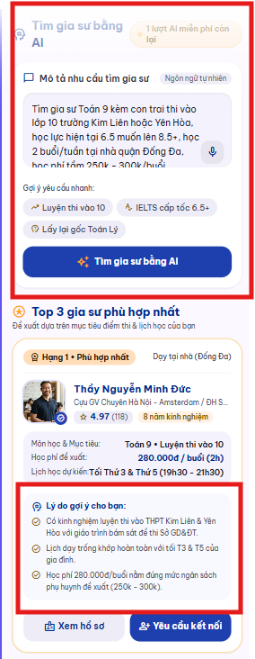

# AI Iteration 02 — Tutor Discovery

## Objective

Làm rõ bộ lọc/sắp xếp và giúp phụ huynh so sánh gia sư từ kết quả AI.

## Scope and execution order

- **Tool:** Google Stitch
- **Prompt sequence:** UX-03 → UX-04; hai prompt được gửi riêng, theo thứ tự lịch sử Agent Log.
- **Original screens:** Manual Tutor Search (UX-03) và AI Tutor Matching (UX-04), theo ảnh Before.

### UX-03 — Manual Tutor Search filters

**Actual prompt:** [UX-03.txt](../prompts/UX-03.txt)

**Before:**

**After:**

**Evaluation:** Ảnh After cho thấy “Bộ lọc” có badge số lượng, “Sắp xếp: Phù hợp nhất”, chip có nút bỏ chọn và “Xóa tất cả”. Canvas Stitch hiển thị nhãn bộ lọc đầy đủ.

**Final decision:** **Accept**

### UX-04 — AI Top 3 recommendations

**Actual prompt:** [UX-04.txt](../prompts/UX-04.txt)

**Before:**

**After:**

**Evaluation:** Canvas Stitch cho thấy đủ ba thẻ xếp hạng, lý do gợi ý cá nhân hóa và hành động xem hồ sơ/yêu cầu kết nối; không thấy phần trăm khớp chưa xác minh. Ảnh After trong repository tập trung vào thẻ hạng 1; xem kết hợp ảnh này với canvas Stitch qua liên kết project cung cấp đủ minh chứng cho Top 3.

**Final decision:** **Accept** — bộ minh chứng gồm ảnh After trong repository và canvas Stitch, trong đó canvas xác nhận cả ba thẻ.

## Reflection

- **What improved:** Bộ điều khiển tìm kiếm và lọc/sắp xếp rõ hơn; canvas AI có ba gia sư với lý do và hành động riêng.
- **Evidence scope (non-blocking):** Ảnh UX-04 trong repository tập trung vào thẻ đầu, canvas Stitch xác nhận đủ ba thẻ; ảnh UX-03 tĩnh không mở bottom sheet sắp xếp. Các giới hạn này không chặn quyết định theo tiêu chí của hai finding.
- **Next action:** Chấp nhận UX-03 và UX-04 theo phạm vi tiêu chí hiện tại; không yêu cầu ảnh hoặc refinement bổ sung.

> Đây là nhóm báo cáo của hai prompt refinement riêng, không khẳng định chúng được gửi trong cùng một lần chạy.
