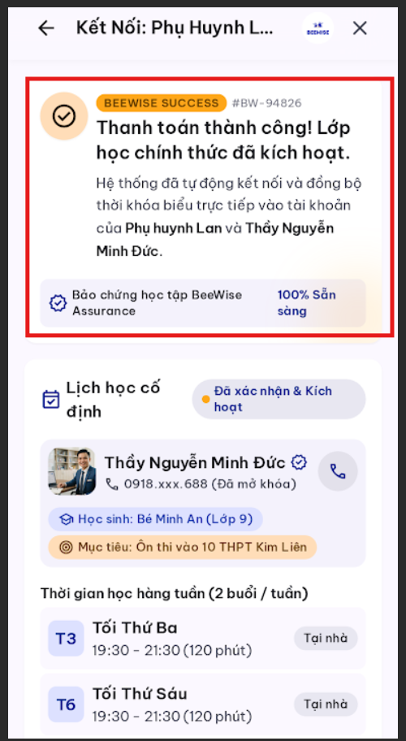
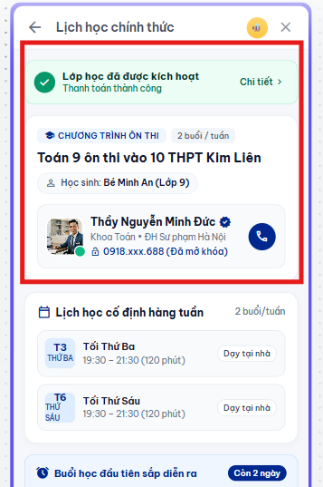

# AI Iteration 03 — Official Schedule

## Objective

Đưa thông tin lịch học lên trước và giảm phần xác nhận lặp lại.

## Scope and execution order

- **Tool:** Google Stitch
- **Prompt sequence:** UX-05; một prompt refinement riêng.
- **Original screen:** Official Schedule, theo ảnh Before.

### UX-05 — Official Schedule

**Actual prompt:** [UX-05.txt](../prompts/UX-05.txt)

**Before:**

**After:**

**Evaluation:** Ảnh After thu gọn xác nhận thanh toán thành một hàng, đặt lớp và gia sư ngay bên dưới, rồi hiển thị rõ hai buổi cố định Thứ Ba và Thứ Sáu từ 19:30 đến 21:30 cùng hình thức dạy tại nhà.

**Final decision:** **Accept**

## Reflection

- **What improved:** Phụ huynh thấy tên lớp, gia sư và lịch hằng tuần sớm hơn; phần xác nhận thanh toán không còn chiếm đầu màn hình.
- **Evidence scope (non-blocking):** Ảnh tập trung vào trạng thái và lịch học, không bao phủ toàn bộ màn hình hoặc các nút cuối trang; giới hạn này không ảnh hưởng tiêu chí ưu tiên lịch học.
- **Next action:** Chấp nhận UX-05; giữ ảnh hiện tại làm minh chứng cho việc ưu tiên lịch học.
