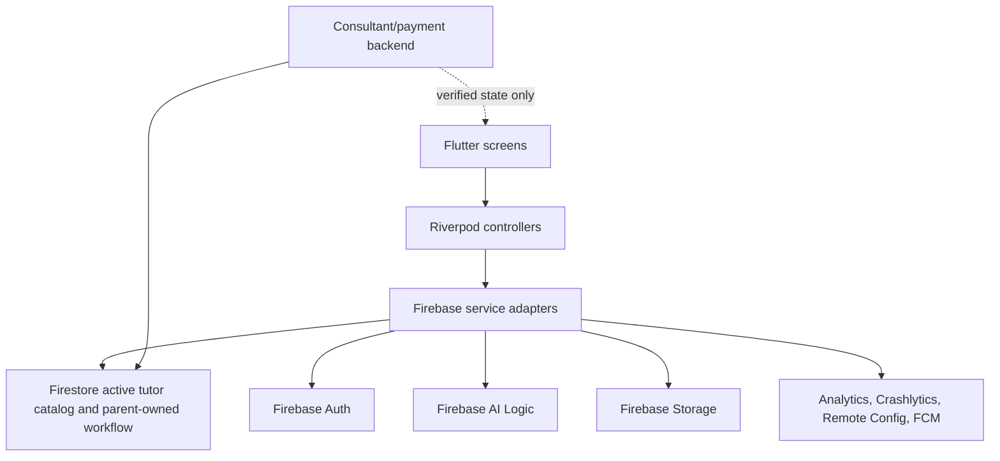
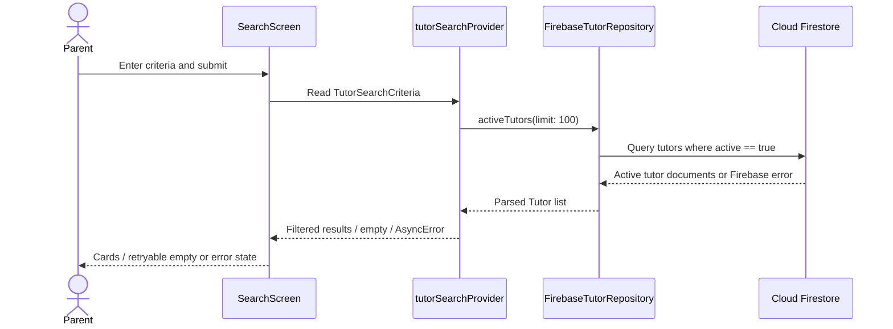

# BeeWise Flutter architecture

## Current implementation

Android client written in Flutter with Riverpod controllers/providers, GoRouter navigation, Firebase service adapters, and a centralized Figma-derived theme. Screens live in `lib/screens/beewise_screens.dart`; service boundaries live in `lib/services/`. No client widget should create/modify trusted tutor, invoice, payment, consultant proposal, or official schedule records directly.

| Layer | Responsibility |
|---|---|
| `lib/app/` | App setup, routes, notification deep-link subscription |
| `lib/screens/` | 12 Lab 2 screens plus account/notification tools; loading, empty, error states |
| `lib/viewmodels/` | Riverpod service providers and async user-intent controllers |
| `lib/services/` | Firebase Auth, Firestore, AI Logic, Storage/PDF, Analytics, Crashlytics, Remote Config, FCM, tutor applications |
| `lib/models/` | Tutor and chat message mapping |
| `lib/theme/` | Figma colors, typography, radius, spacing and components |
| `firebase/` | Firestore/Storage rules and Remote Config defaults |
| `docs/` | Product, traceability, analytics, test, review and setup decisions |
| `e2e_test/` | Pinned ARTEMIS Python SDK, pytest fixtures and independent mobile scenarios |
| `evidence/` | Captured Firebase, device and ARTEMIS evidence; currently awaiting live runs |

## Data flow and trust boundaries

Firestore is the selected tutor catalog adapter. Home/search only read documents with `active: true`; the client does not create or edit tutor profiles. AI matching sends the parent’s non-identifying learning description and active tutor facts to Firebase AI Logic, then accepts only IDs present in the Firestore result. Keep prompts free of parent name, email, phone, and chat history.

The parent can create a connection request, send text in their own chat, and append an allowed workflow response. Only trusted consultant/backend services may publish consultant widgets, create invoices, verify payments, and create official class schedules. The client may request payment verification; it never writes a paid/verified status. Storage reports use `reports/{uid}/...` and rules restrict access to that UID.

## Search request sequence

## Service and provider inventory

`AuthService`, `TutorRepository`, `MatchingService`, `ChatService`, `WorkflowService`, and `ExportService` isolate product operations. `AnalyticsService`, `CrashReportingService`, `RemoteConfigService`, and `NotificationService` wrap Firebase observability/configuration. Riverpod providers expose their data and controllers to screens.

| ViewModel/controller or provider | Service dependencies | Owned state or action |
|---|---|---|
| `authStateProvider` / `AuthController` | `AuthService`, `AnalyticsService`, `CrashReportingService`, `NotificationService` | Auth stream; sign-in, registration, sign-out and identity instrumentation |
| `TutorApplicationController`, application-status provider | `TutorApplicationService`, `AnalyticsService`, `CrashReportingService`, `NotificationService` | Create/read own tutor application; always pending on client; no client approval or public profile write |
| `activeTutorsProvider`, `tutorSearchProvider`, `tutorProvider` | `TutorRepository`, `RemoteConfigService` | Async catalog/profile/search data and filter results |
| `MatchingController` | `MatchingService`, `AnalyticsService`, `CrashReportingService` | AI match loading/results/error and outcome event |
| `ConnectionController` | `ChatService`, `AnalyticsService`, `CrashReportingService` | Atomic request/chat submission state |
| `chatMessagesProvider`, `parentChatsProvider`, `ChatComposerController` | `ChatService`, `CrashReportingService`, `AnalyticsService` | Message/chat streams and send state |
| `WorkflowController`, `invoiceQueryProvider`, `scheduleProvider` | `WorkflowService`, `AnalyticsService`, `CrashReportingService` | Parent responses, invoice and verified schedule streams |
| `ReportController` | `ExportService`, `AnalyticsService`, `CrashReportingService`, auth state | PDF build, upload progress/result/error |
| notification providers | `NotificationService` | Permission, received notification list, opened-route stream |

Screens consume Riverpod state/providers and call intent controllers. Firebase SDK instances are created at the provider composition boundary and injected into service adapters; widgets do not call Firebase SDKs directly. Search filtering is in the repository utility/service layer, not in `build()`.

## Setup constraints

Firebase project `beewise-lab-3` is registered, Android options are generated for package `com.beewise.beewise`, Email/Password Auth is enabled, and the default Firestore database is provisioned in `asia-southeast1`. The baseline Firestore rules were published before the tutor-application change; updated local rules still need emulator validation and publishing. Real tutor data, Google OAuth/support email, App Check debug-token registration, FCM test account, and consultant/payment backend remain external setup. Firebase Storage is not usable on the current Spark plan; enabling it requires Blaze billing. ARTEMIS and Firebase setup instructions are in [README.md](../README.md).

## Known gaps to resolve before claiming the lab fully complete

- Seed a real active tutor catalog and designated non-production account in the configured Firebase project.
- Confirm the project-owned tutor review process, secure document requirements/retention, and staff/backend approval path before adding uploads or approval UI.
- Confirm the project’s AI Logic/App Check settings and validate a successful match.
- Define/implement server-authored consultant proposal, invoice issuance, payment verification, and schedule creation.
- Define the product persistence contract for the guest’s one-successful-AI-match allowance.
- Validate `tutor_search` and `tutor_profile_view` in Firebase Analytics DebugView.
- Configure ARTEMIS with the user’s permitted model key; execute each scenario at least three times and retain replay evidence.
- Three local AI-review fixes are in the working tree; create separate commits after review if the Lab requires commit evidence. If the course requires a hosted PR review, attach that tool’s output separately.
