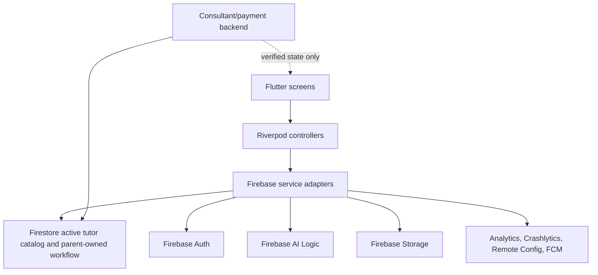
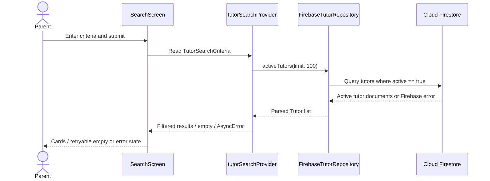

# BeeWise Flutter architecture

## Current implementation

Android client written in Flutter with Riverpod controllers/providers, GoRouter navigation, Firebase service adapters, and a centralized Figma-derived theme. Screens live in `lib/screens/beewise_screens.dart`; service boundaries live in `lib/services/`. No client widget should create/modify trusted tutor, invoice, payment, consultant proposal, or official schedule records directly.

| Layer | Responsibility |
|---|---|
| `lib/app/` | App setup, routes, notification deep-link subscription |
| `lib/screens/` | 12 Lab 2 screens plus account/notification tools; loading, empty, error states |
| `lib/viewmodels/` | Riverpod service providers and async user-intent controllers |
| `lib/services/` | Firebase Auth, Firestore, AI Logic, Storage/PDF, Analytics, Crashlytics, Remote Config, FCM, tutor applications |
| `lib/models/` | Tutor and chat message mapping |
| `lib/theme/` | Figma colors, typography, radius, spacing and components |
| `firebase/` | Firestore/Storage rules and Remote Config defaults |
| `docs/` | Product, traceability, analytics, test, review and setup decisions |
| `e2e_test/` | Pinned ARTEMIS Python SDK, pytest fixtures and independent mobile scenarios |
| `evidence/` | Captured Firebase, device and ARTEMIS evidence; currently awaiting live runs |

## Data flow and trust boundaries

Firestore is the selected tutor catalog adapter. Home/search only read documents with `active: true`; the client does not create or edit tutor profiles. AI matching sends the parent’s non-identifying learning description and active tutor facts to Firebase AI Logic, then accepts only IDs present in the Firestore result. Keep prompts free of parent name, email, phone, and chat history.

The parent can create a connection request, send text in their own chat, and append an allowed workflow response. Only trusted consultant/backend services may publish consultant widgets, create invoices, verify payments, and create official class schedules. The client may request payment verification; it never writes a paid/verified status. Storage reports use `reports/{uid}/...` and rules restrict access to that UID.

## Search request sequence

## Service and provider inventory

`AuthService`, `TutorRepository`, `MatchingService`, `ChatService`, `WorkflowService`, and `ExportService` isolate product operations. `AnalyticsService`, `CrashReportingService`, `RemoteConfigService`, and `NotificationService` wrap Firebase observability/configuration. Riverpod providers expose their data and controllers to screens.

| ViewModel/controller or provider | Service dependencies | Owned state or action |
|---|---|---|
| `authStateProvider` / `AuthController` | `AuthService`, `AnalyticsService`, `CrashReportingService`, `NotificationService` | Auth stream; sign-in, registration, sign-out and identity instrumentation |
| `TutorApplicationController`, application-status provider | `TutorApplicationService`, `AnalyticsService`, `CrashReportingService`, `NotificationService` | Create/read own tutor application; always pending on client; no client approval or public profile write |
| `activeTutorsProvider`, `tutorSearchProvider`, `tutorProvider` | `TutorRepository`, `RemoteConfigService` | Async catalog/profile/search data and filter results |
| `MatchingController` | `MatchingService`, `AnalyticsService`, `CrashReportingService` | AI match loading/results/error and outcome event |
| `ConnectionController` | `ChatService`, `AnalyticsService`, `CrashReportingService` | Atomic request/chat submission state |
| `chatMessagesProvider`, `parentChatsProvider`, `ChatComposerController` | `ChatService`, `CrashReportingService`, `AnalyticsService` | Message/chat streams and send state |
| `WorkflowController`, `invoiceQueryProvider`, `scheduleProvider` | `WorkflowService`, `AnalyticsService`, `CrashReportingService` | Parent responses, invoice and verified schedule streams |
| `ReportController` | `ExportService`, `AnalyticsService`, `CrashReportingService`, auth state | PDF build, upload progress/result/error |
| notification providers | `NotificationService` | Permission, received notification list, opened-route stream |

Screens consume Riverpod state/providers and call intent controllers. Firebase SDK instances are created at the provider composition boundary and injected into service adapters; widgets do not call Firebase SDKs directly. Search filtering is in the repository utility/service layer, not in `build()`.

## Verified setup constraints (2026-10-30)

Committed Android Firebase client options target `beewise-lab-3`. Live services,
provider setup, deployment and project billing were not verified in this run.
Old cloud/machine observations are not current evidence. Firestore/Storage rules
passed 26 real tests on the local demo project. Production was not changed.

Parent registration supports ownership-authenticated recovery of a missing
profile; login merges existing profile without overwriting its display name.
Tutor application remains a private pending record, not a trusted public tutor.
Notification v2 keys are per UID and require `recipientUid`; guest/ownerless and
mismatched messages are dropped. OS shade and live FCM need separate validation.

Workflow responses use deterministic proposal IDs and a client transaction.
Rules independently require the current consultant proposal/revision, pending
status and future expiry. The missing trusted backend must implement
[backend-contract.md](backend-contract.md), including immutable receipt-driven
payment/schedule transitions and real installation ownership checks.

Search still caps at 100 active tutors, guest quota persistence remains a product
decision, and chat activity ordering requires a trusted projection. No backend,
live AI matching, console evidence or Android layout validation is claimed.
