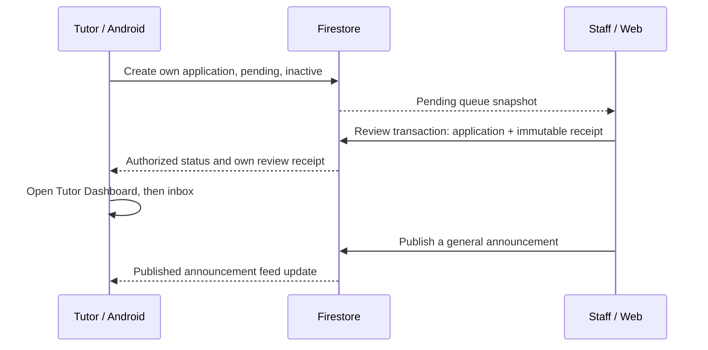

# Tutor application: Mobile to Web Admin

| Step | Actor and screen | Operation | Security check | Visible result |
|---|---|---|---|---|
| 1 | Applicant, Android registration | CREATE tutorApplications/{authUid} | Owner; no parent record; pending/false/false and server timestamp | Application status pending |
| 2 | Staff, Web review queue | QUERY pending tutorApplications | Verified Google token plus users/{uid}.role; rules apply to the whole query | The same application appears in the queue |
| 3 | Staff, application detail | Atomic UPDATE + CREATE reviews/{reviewId} | No self-review; pending transition; receipt, actor, decision, reason and timestamp must match | Pending entry leaves queue; history shows decision |
| 4 | Applicant, Android status | Listen to application doc; open workspace | Approved plus verified and active; same UID | T2 shows approval and the tutor workspace CTA |
| 5 | Tutor, Android bell/inbox | Listen to own reviews subcollection | Owner only (reviewers may read in Web); no navigation payload from Firestore | Private approval notification, separate from FCM |
| 6 | Staff / signed-in Android user | CREATE published announcement; listen to published query | Staff author and timestamp; signed-in published reads only | General announcement in existing inbox |

Measure from Web approval action to the first visible approved Android state on the same clock. Record each synthetic alias, original screen captures, environment, SHA and latency; never use Admin writes for applicant submission or approval in an acceptance run. Emulator and deployed results are separate. Deployed acceptance is pending owner-approved cloud configuration and deployment.

See [Production cross-role evidence and run plan](../evidence/final/production-cross-role/README.md) for the current deployed scope, evidence and pending gates.
