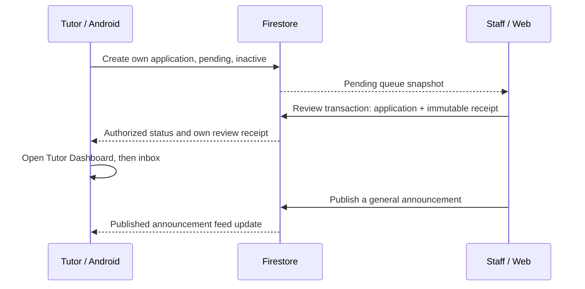

# Tutor application: Mobile to Web Admin

| Step | Actor and screen | Operation | Security check | Visible result |
|---|---|---|---|---|
| 1 | Applicant, Android registration | CREATE tutorApplications/{authUid} | Owner; no parent record; pending/false/false and server timestamp | Application status pending |
| 2 | Staff, Web review queue | QUERY pending tutorApplications | Verified Google token plus users/{uid}.role; rules apply to the whole query | The same application appears in the queue |
| 3 | Staff, application detail | Atomic UPDATE + CREATE reviews/{reviewId} | No self-review; pending transition; receipt, actor, decision, reason and timestamp must match | Pending entry leaves queue; history shows decision |
| 4 | Applicant, Android status | Listen to application doc; open workspace | Approved plus verified and active; same UID | T2 shows approval and the tutor workspace CTA |
| 5 | Tutor, Android bell/inbox | Listen to own reviews subcollection | Owner only (reviewers may read in Web); no navigation payload from Firestore | Private approval notification, separate from FCM |
| 6 | Staff / signed-in Android user | CREATE published announcement; listen to published query | Staff author and timestamp; signed-in published reads only | General announcement in existing inbox |

Production: Flutter Web Admin is deployed at [beewise-lab-3.web.app](https://beewise-lab-3.web.app/) on Firebase project `beewise-lab-3`. Firestore Rules were deployed after separate owner approval, the VietQR query index reached READY, and the Final Android debug APK connected to production Firebase.

Production approvals are now verified **`3/3`** across independent disposable synthetic accounts (**`CR-01`**, **`CR-04`**, **`CR-05`**), alongside `CR-02` (needs_info & resubmission to pending) and `CR-03` (rejection with reason on Android). On **`CR-04`** and **`CR-05`**, Android updated from pending to approved without reload, navigated to `/tutor/home` and `/tutor/notifications` showing the private approval receipt, and independent anonymized Firestore REST readbacks confirmed `tutorApplications/{uid}` (`status="approved"`, `verified=true`, `active=true`), `reviews/{reviewId}` (`reviews_subcollection_count=1`), and `public_tutor_doc_exists=false`. Applicants needing corrections or rejected see the reason on their status screen; the approved tutor workspace and inbox stay restricted by design. Synthetic `CR-04`/`CR-05` documents contain no raw PII and remain retained in `beewise-lab-3` per owner Gate 1 approval.

[Production evidence](../evidence/final/production-cross-role/README.md) records the remaining boundaries: Web App Check token path and release Play Integrity unverified, Analytics native `HTTP 204` upload bundles verified (`ai_request`, `ai_result_accepted`, `ai_error` in [`native-receipt.json`](../evidence/final/analytics/native-receipt.json); Console DebugView UI screenshot `NOT_CAPTURED`), direct production Rules denial `NOT_RUN` (covered by 75/75 local Firestore Security Rules tests), Appendix C propagation timing **`NOT_MEASURED`**, and bounded Gate 3 Option B ARTEMIS completed (`4/9` accepted PASS; remaining flows `NOT_RUN`; see [`docs/artemis-final-matrix.md`](artemis-final-matrix.md)).
