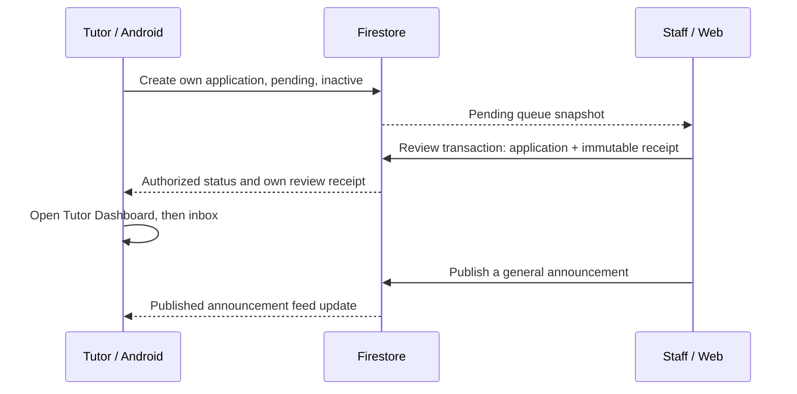

# Tutor application: Mobile to Web Admin

| Step | Actor and screen | Operation | Security check | Visible result |
|---|---|---|---|---|
| 1 | Applicant, Android registration | CREATE tutorApplications/{authUid} | Owner; no parent record; pending/false/false and server timestamp | Application status pending |
| 2 | Staff, Web review queue | QUERY pending tutorApplications | Verified Google token plus users/{uid}.role; rules apply to the whole query | The same application appears in the queue |
| 3 | Staff, application detail | Atomic UPDATE + CREATE reviews/{reviewId} | No self-review; pending transition; receipt, actor, decision, reason and timestamp must match | Pending entry leaves queue; history shows decision |
| 4 | Applicant, Android status | Listen to application doc; open workspace | Approved plus verified and active; same UID | T2 shows approval and the tutor workspace CTA |
| 5 | Tutor, Android bell/inbox | Listen to own reviews subcollection | Owner only (reviewers may read in Web); no navigation payload from Firestore | Private approval notification, separate from FCM |
| 6 | Staff / signed-in Android user | CREATE published announcement; listen to published query | Staff author and timestamp; signed-in published reads only | General announcement in existing inbox |

Production: Flutter Web Admin is deployed at [beewise-lab-3.web.app](https://beewise-lab-3.web.app/) on Firebase project `beewise-lab-3`. Firestore Rules were deployed after separate owner approval, the VietQR query index reached READY, and the Final Android debug APK connected to production Firebase.

Three distinct live UI scenarios were observed: CR-01 approval (private inbox notice owner-observed), CR-02 request for corrections and return to pending, and CR-03 rejection. Android showed state changes without reload per owner observation. Applicants needing corrections or rejected see the reason on their status screen; the approved tutor workspace and inbox stay restricted by design. Two additional approval repetitions were not run. Independent Firestore receipt readback was not captured.

[Production evidence](../evidence/final/production-cross-role/README.md) records the boundaries: Web App Check token path and release Play Integrity unverified, Analytics receipts pending, direct production Rules denial not run, and ARTEMIS Final deferred. Appendix C propagation timing was not collected.
