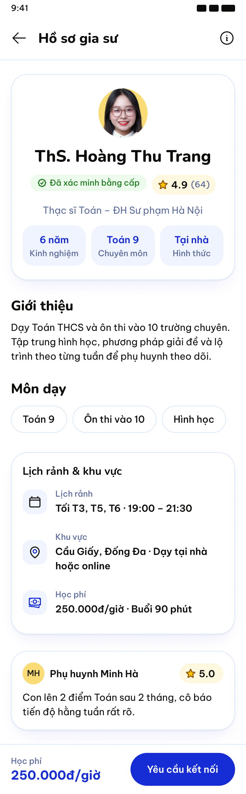

# BeeWise — Flutter handoff

## Scope and source of truth

- Product: Vietnamese Android app for parents finding and connecting with tutors.
- Canonical screen order: [UX sitemap](../ux/sitemap.md), IDs 01–12. The first-generation Batch 01 prompt swapped IDs 02 and 03; use the sitemap order below.
- Figma: [BeeWise-Design](https://www.figma.com/design/gqbuTDuZYOyKyP8LsUwobC/BeeWise-Design?node-id=2-3&t=XLL8PoLbIdyZCOIC-1). Refer to its **Final UI**, **Design System**, and **Components** pages for final layouts, literal variable/style names, and values.
- Local visual evidence: [Figma screen index](../assets/figma-screens/README.md) and [user-flow diagrams](../ux/user-flow.md).
- No Flutter source or router choice is present in this repository. Route names below are conceptual. Color, text, spacing, radius, and effect values below were read from the linked Figma Design System page.

The [Screen 04 Tutor Profile screenshot](../assets/figma-screens/04-tutor-profile.png) is the supplied reference for that screen. It shows the profile summary, verified badge, rating, experience/subject/mode tiles, introduction, subject chips, availability/location/tuition, a review, and a bottom connection action. Tutor identities, prices, reviews, dates, and verification shown in screenshots are illustrative. Some PNGs contain transparency: black seen behind transparent areas in an image viewer is not the app background. Build native Flutter layouts from the Figma frames; do not use a full-screen PNG as the screen implementation.

## Shared layout and behavior

- **Viewport:** Figma's compact layout is 360 × 800dp and its responsive check is 412 × 915dp. The Home frame is also recorded as 402 × 874 px while the other 11 primary frames are 360 px wide. Keep Home responsive to the 360dp app width and verify at 412dp; do not scale or crop the supplied screenshot to resolve the mismatch. Frame heights are design canvases, not device viewport heights.
- **Structure:** use `Scaffold`/`SafeArea`, a 64dp app bar, and scrollable content. Keep only the actions/navigation shown for that screen anchored to the bottom. Screens 01–03 use the five-tab, 72dp main bottom navigation; auth, profile, connection, chat, and onboarding detail screens use their own headers and actions.
- **Responsive/accessibility:** use 16dp screen margins, 24dp between content sections, and 16dp card padding. Body copy ≥14sp; caption 12sp is reserved for metadata. Interactive targets ≥48 × 48dp; support text scaling and Vietnamese wrapping. Keep fees, status, consent text, and primary actions readable without truncation. Pair status color with text/icon and semantic labels. The tested Figma text/background pairs meet 4.5:1 normal-text contrast; preserve those pairings. Use safe-area and keyboard insets; scroll a focused field into view and retain entered values after validation or network errors.
- **Assets/theme:** use Nunito for headings and Be Vietnam Pro for body/labels, as set in Figma. Bind color, typography, spacing, radius, and effects to the Figma variables/styles. Use supplied logo, mascot, and tutor assets where available; keep decorative imagery from reducing contrast or action space.
- **Guest access:** guests may use Home, manual search, tutor profiles, and the one free successful AI match. Connection requires authentication. After login/register, restore the selected tutor and pending connection intent, then continue to Screen 07.
- **AI allowance:** the guest gets one successful AI matching attempt. Decrement the allowance only when matching succeeds; a processing failure or no-match response leaves the attempt available. A subsequent attempt by a guest opens the login/register gate and returns to AI matching afterward. The repository does not specify how allowance state is persisted; use the product service/session contract rather than inventing local-only persistence.
- **Onboarding gates:** only create Screen 08 after the parent confirms the connection request and it succeeds. Screen 08 is a three-party conversation: parent, tutor, BeeWise consultant. The consultant manually sends both the trial proposal and class-confirmation widget. The system exposes payment only after the parent confirms the current class-confirmation revision. The official schedule appears only after payment is verified successful. Never advance from a tap alone when the server/provider has not confirmed the transition.

## Figma design tokens → Flutter

Values below are from **4. Design System — BeeWise Mobile** in the linked Figma file. Keep the Figma token names as the source of truth; centralize them in Flutter rather than duplicating literals in screens.

### Colors

| Figma token | Value | Flutter mapping |
|---|---|---|
| `bg/canvas` | `#F0F4FF` | `scaffoldBackgroundColor` |
| `bg/surface` | `#FFFFFF` | `ColorScheme.surface` |
| `bg/primary` | `#162CD4` | `ColorScheme.primary` |
| `bg/accent` | `#FFC500` | `ColorScheme.tertiary` |
| `bg/highlight` / `bg/accent-soft` | `#FADC76` / `#FFF8E0` | BeeWise theme extension; preserve foreground pairing from `text/on-accent` |
| `bg/success` / `bg/success-soft` | `#32CD32` / `#ECFBEC` | BeeWise status colors |
| `bg/error-soft` / `bg/destructive` | `#FEF7F6` / `#DC2626` | `ColorScheme.errorContainer` / `error` where matching |
| `bg/disabled` / `bg/inverse` | `#DCE8FB` / `#0C0C0B` | Disabled surface / `ColorScheme.inverseSurface` |
| `bg/primary-pressed` | `#280F91` | Primary button pressed `WidgetStateProperty` |
| `text/primary` / `text/muted` | `#0C0C0B` / `#5A6A9A` | `ColorScheme.onSurface` / `onSurfaceVariant` |
| `text/brand` / `text/on-primary` | `#162CD4` / `#FFFFFF` | `ColorScheme.primary` / `onPrimary` |
| `text/on-accent` | `#0C0C0B` | `ColorScheme.onTertiary` |
| `text/destructive` / `text/warning` / `text/success` | `#DC2626` / `#905B0F` / `#1F7A1F` | BeeWise status colors; keep text/icon status as well as color |
| `icon/default` / `icon/muted` | `#0C0C0B` / `#5A6A9A` | `onSurface` / `onSurfaceVariant` |
| `icon/brand` / `icon/accent` / `icon/on-primary` | `#162CD4` / `#FFC500` / `#FFFFFF` | `primary` / `tertiary` / `onPrimary` |
| `icon/success` / `icon/destructive` | `#1F7A1F` / `#DC2626` | BeeWise status colors / `error` |
| `border/default` / `border/strong` | `#DCE8FB` / `#C9D1E3` | `ColorScheme.outlineVariant` / `outline` |
| `border/focus` / `border/error` / `border/brand` | `#280F91` / `#DC2626` / `#162CD4` | Focus / error / primary control outline |
| `border/error-soft` | `#E1ABA7` | BeeWise error border token |

### Type, spacing, shape, and effects

| Figma style/token | Value | Flutter mapping |
|---|---|---|
| `Display` | Nunito ExtraBold, 28/36 | `TextTheme.display*` |
| `Heading/H1`, `Heading/H2`, `Heading/H3` | Nunito ExtraBold 24/30, Nunito ExtraBold 20/26, Nunito Bold 16/22 | `headline*` / `title*` |
| `Body/Large`, `Body/Medium`, `Body/Strong` | Be Vietnam Pro Regular 16/24, Regular 14/21, SemiBold 14/21 | `bodyLarge`, `bodyMedium`, and strong body style |
| `Label/Button`, `Label/Chip` | Be Vietnam Pro SemiBold 14/20, Medium 14/20 | `labelLarge` and shared chip label style |
| `Price`, `Caption` | Be Vietnam Pro Bold 18/24, Medium 12/16 | Price style; `labelSmall`/metadata style |
| `space/1`, `/2`, `/3`, `/4`, `/5`, `/6`, `/8`, `/10`, `/12` | 4, 8, 12, 16, 20, 24, 32, 40, 48dp | Shared spacing constants. Figma notes 16dp screen margin, 24dp section gap, 16dp card padding. |
| `radius/sm`, `/md`, `/field`, `/card`, `/panel`, `/full` | 8, 12, 16, 24, 32, 999dp | Shared `BorderRadius` tokens |
| `Elevation/Soft`, `Elevation/Soft Hover`, `Elevation/Pop` | Named effect styles | Shared `BoxShadow`/theme styles for cards/panels, pressed/hover cards, and dialogs/menus/sheets respectively |

Use the 11 Figma text styles as named styles; the `TextTheme` names above are target roles, not a request to replace the Figma weights or line heights. Bind the three effect styles to their Figma settings instead of approximating their shadows.

## Figma components → Flutter widgets

| Figma component | Flutter widget/pattern | Variants to preserve |
|---|---|---|
| Button | `FilledButton`, `OutlinedButton`, `TextButton` | Figma Style × State: Default/Pressed/Disabled/Loading. |
| IconButton | `IconButton` | Ghost/Tonal/Primary × Default/Pressed; 48dp hit area. |
| Chip | `FilterChip`, `Chip`, `ChoiceChip`, or `ActionChip` | Selected/removable; six tones; suggestion, filter, and subject roles. |
| Badge | Small custom `Container`/`Badge` | Verified, rating, role, workflow status; include text/icon meaning. |
| Avatar | `CircleAvatar` or clipped image | S/M/L; image, initials/fallback, loading/error. |
| Rating | Custom row with star icon and text | Rating plus review count; support “no reviews” without a fake score. |
| TextField + SearchBar | `TextFormField` and `SearchBar` | Default/Focused/Filled/Error/Disabled; password obscured/revealed; semantic label/helper/error. |
| AppBar | `AppBar` or screen-specific toolbar | Back/title/action combinations; preserve safe-area and long-title behavior. |
| BottomNav | `NavigationBar` | Selected/unselected destinations; guest taps on protected areas show the auth/prerequisite gate. |
| OnboardingStepper | Custom compact stepper | Complete/current/upcoming; status is not conveyed by color alone. |
| TutorCard + InfoRow | `Card`, `ListTile` or shared custom widget | Search/AI result density; use shared Figma instances/tokens. |
| Alert | `MaterialBanner`, inline alert, or `SnackBar` by persistence | Info/success/warning/error; persistent blocking states stay inline. |
| Dialog | `showDialog` + `AlertDialog` | Confirm/Login required/Destructive. |
| Loading | `CircularProgressIndicator`, skeleton/Shimmer, `LinearProgressIndicator` | Spinner/Skeleton card/AI progress. |
| EmptyState | Shared `EmptyStateView` | Search/Chat. |
| ErrorState + Alert | Shared `ErrorView`, `MaterialBanner` | AI failed/Payment failed/Network; Error/Success/Info/Warning. |
| ChatBubble | Custom role-aware message bubble | Parent/tutor/consultant/system, time, pending/delivered/failed. |
| Icons, BeeWise logo, mascot | `Icon`/SVG or image asset | Use supplied assets and accessible labels; decorative art is excluded from semantics. |

## Screen specifications

### 01 — Home

- **Layout:** Brand/app bar and notification action; greeting and discovery heading; search/filter entry; AI banner; subject chips; tutor sections/cards; persistent main navigation.
- **Components/variants:** AppBar, SearchBar, AI promotion with guest-allowance badge, subject Chip, TutorCard (home/compact), Button, BottomNav (Home selected), Loading/EmptyState/ErrorState.
- **States:** Guest and signed-in; discovery content; loading; empty recommendations; service error. AI banner shows remaining free attempt only when eligible.
- **Interactions/validation:** Search opens Screen 03 with query; filter opens the filter sheet; AI CTA opens Screen 02; tutor card opens Screen 04; connection CTA follows auth gate and preserves tutor ID. Do not require login for browsing. No query limit is defined by the supplied Figma evidence.
- **Navigation/Back:** Entry/root screen. Bottom destinations open Home, Search, AI, Messages, and Account; protected destinations show authentication or prerequisite messaging. Back follows Android root behavior.
- **Responsive/UI:** Scroll all discovery content; adapt cards/chips to available width and wrap rows. Home's source frame is 402px wide despite the 360dp base; fit the parent width and verify at 360dp and 412dp. Keep bottom navigation within the safe area.

### 02 — AI Tutor Matching

- **Layout:** Back/title app bar; free-attempt information banner; natural-language need field with 500-character counter; optional criteria chips; primary AI action; manual-search alternative; main bottom navigation. Results use a need summary and three ranked tutor cards with explanations.
- **Components/variants:** AppBar, Alert (allowance/login gate), multiline TextField, suggestion Chips, Button, TutorCard (ranked), Loading, EmptyState/ErrorState, BottomNav (AI selected).
- **States:** Eligible guest; allowance used/login required; empty input; loading; three results; no match; processing failure/retry. Only a successful match consumes the guest attempt.
- **Interactions/validation:** Trim whitespace and reject an empty request; enforce the visible 500-character maximum. Loading must not consume the attempt. On failure/no match preserve text and allow retry. Result card opens Screen 04. “Tự tìm theo bộ lọc” opens Screen 03. After a guest's successful attempt, a new request goes through login/register and returns here.
- **Navigation/Back:** Home or AI tab → Screen 02; result → Screen 04; manual alternative → Screen 03. Back returns to the prior screen and keeps the draft.
- **Responsive/UI:** Keep the input and actions full-width with wrapping chips; allow result cards to stack and scroll. Keep the bottom navigation visible without covering the final action or keyboard-focused content.

### 03 — Manual Tutor Search

- **Layout:** Back/title app bar; query SearchBar with filter action; filter-count button and sort control; removable active-filter chips plus clear-all; result count and stacked tutor cards; AI alternative card; main bottom navigation.
- **Components/variants:** SearchBar, filter/sort controls, FilterChip, bottom sheet/dialog for criteria, TutorCard (search), AI alternative card, Loading/EmptyState/ErrorState, BottomNav (Search selected).
- **States:** Default/results; loading; filters applied; filter sheet; sort sheet; empty results; query/network error.
- **Interactions/validation:** Search by subject/grade/location and filters for subject, grade, price, area, and teaching mode. Removing a chip updates results; clear-all resets filters; sorting remains separate from filters. Tutor card opens Screen 04; AI alternative opens Screen 02. Keep query and scroll position on return. No maximum query length or debounce duration is specified in the target repo.
- **Navigation/Back:** Home/AI → Screen 03; tutor → Screen 04; Back dismisses an open sheet first, then returns to the prior screen.
- **Responsive/UI:** Stack cards in one column; let chips wrap; use a scrollable bottom sheet on short viewports. Keep filter/sort hit areas ≥48dp and preserve filter labels at text scale.

### 04 — Tutor Profile

- **Layout:** Back/info app bar; centered profile card with avatar, name, verified-credential badge, rating/review count, education and three summary tiles; scrollable introduction and subject chips; availability/location/teaching-mode/tuition card; review card; bottom action area with hourly fee and “Yêu cầu kết nối”.
- **Components/variants:** AppBar (back + info), Avatar, Badge (verified/unverified), Rating (rated/no reviews), InfoRow/stat tiles, subject Chips, Card, sticky Button. The screenshot's tutor, credentials, review, availability, and fee are illustrative content.
- **States:** Loading/skeleton; loaded/verified; unverified; no reviews; unavailable/error; connection submitting. Do not imply a credential or rating that the tutor data does not contain.
- **Interactions/validation:** “Yêu cầu kết nối” opens Screen 05/06 for a guest and returns to Screen 07 after auth; signed-in parent goes to Screen 07 directly. Preserve tutor ID, originating results/filter state, and pending intent. The info action may expose credential details. No connection is sent from this profile tap.
- **Navigation/Back:** Open from Home, Search, or AI results. Back returns to the originating list and restores its query/scroll state. Login/register continuation goes to Screen 07, not a new tutor search.
- **Responsive/UI:** Keep the profile summary readable in one column; summary tiles may wrap at 360dp. Scroll long intro/reviews and keep the fee/action area above system insets. At 412dp, use added width for card padding/columns only where Figma shows it; do not stretch text lines excessively.

### 05 — Login

- **Layout:** Back/title app bar; BeeWise logo; selected-tutor continuation card when login was opened from a connection request; login heading; email-or-phone and password fields; forgot-password link; primary login, Google sign-in, and register link.
- **Components/variants:** AppBar, logo, TutorCard (compact continuation), TextField (email/phone, password obscured/revealed), Button (primary/Google), inline Alert, text links.
- **States:** Empty/filled; focused; field validation; submitting; authentication failure; Google flow pending/failure; success.
- **Interactions/validation:** Require a valid email or phone and a non-empty password; show errors beside fields and retain entered values/tutor context. Forgot password starts recovery if configured. Google sign-in follows the same pending continuation. Successful auth resumes the pending connection at Screen 07; do not lose the selected tutor.
- **Navigation/Back:** Entry from connection gate returns to Screen 04 when backed out; Register → Screen 06; success → Screen 07 when connection is pending, otherwise the requested destination.
- **Responsive/UI:** Single-column scrollable form; keyboard insets keep the submit action reachable and focus-visible. Never use a fixed viewport height; allow the tutor continuation card and long errors to wrap.

### 06 — Register

- **Layout:** Back/title app bar; BeeWise logo; parent-account heading and continuation copy; full name, phone, email, and password fields; terms/privacy consent; create-account CTA and login link.
- **Components/variants:** AppBar, logo, TextField (name/phone/email/password), consent Checkbox with linked text, Button, inline field errors.
- **States:** Empty/filled; focused; invalid fields; consent unchecked; submitting; account exists/network error; success.
- **Interactions/validation:** Require name, valid phone and email, password ≥8 characters and at least one digit as shown by the design, and accepted terms/privacy. Preserve values on error. Batch 02's generation prompt mentions a confirm-password field, but the supplied final screenshot does not show one; follow the linked Final UI frame and do not add an unshown field without resolving that Figma difference. After successful registration resume Screen 07 with the selected tutor/intent.
- **Navigation/Back:** Login link → Screen 05; back returns to the connection flow/profile without sending a request; success → Screen 07 when connection is pending.
- **Responsive/UI:** Keep the form single-column and scrollable; wrap consent/legal text; ensure checkbox and links meet touch targets. Keyboard must not hide the focused field or primary action.

### 07 — Connection Request

- **Layout:** Back/title app bar; BeeWise connection illustration; selected tutor summary (name, subject/grade, hourly fee, teaching mode, verification); request details (learning goal, area, preferred schedule, optional note); explanation that BeeWise creates a three-person chat; bottom “Gửi yêu cầu kết nối” action.
- **Components/variants:** AppBar, mascot illustration, TutorCard (request summary), InfoRow, optional multiline TextField, Alert (next step), Button, confirmation dialog if required by prototype.
- **States:** Review; submit confirmation; submitting; sent; service error; selected tutor unavailable.
- **Interactions/validation:** A guest must authenticate before sending and return here with the same tutor and intent. Send only after explicit parent action; disable repeat taps while submitting. On success create/open the group chat. “Để sau”/back cancels without creating a request. Preserve any note if submission fails.
- **Navigation/Back:** Screen 04 → auth (guest) → Screen 07; signed-in Screen 04 → Screen 07. Successful request → Screen 08. Back returns to Screen 04.
- **Responsive/UI:** Scroll request details above a bottom action; keep tutor summary and next-step explanation visible without clipping. Long goals and schedule text wrap. Respect safe area for the pinned action.

### 08 — Group Chat

- **Layout:** Group title/back/info app bar; three-member summary and onboarding status; chronological message list with system notices; consultant, tutor, and parent bubbles; consultant-sent proposal/class widgets within the thread; pinned message composer with attachment/add and send actions.
- **Components/variants:** AppBar, Avatar, role Badge, Alert/system event, ChatBubble (three roles + system), trial/class widget cards, TextField composer, IconButton/Send Button, EmptyState, delivery status.
- **States:** Newly connected/empty; populated; sending; delivered; failed/retry; consultant trial proposal present; class widget present; onboarding status updates. The three roles are always parent, tutor, BeeWise consultant.
- **Interactions/validation:** Trim and reject an empty message; preserve draft and list position when opening a widget. Retry failed sends without duplicating delivered messages. Tapping a manually sent trial widget opens Screen 09; a manually sent class-confirmation widget opens Screen 10 after the trial. The app must not create/send either widget automatically.
- **Navigation/Back:** Successful Screen 07 → Screen 08. Back returns to the prior app destination. Widget taps open Screen 09/10; details return to this exact group thread. Main Messages tab may reopen the group.
- **Responsive/UI:** Message list owns remaining height; composer remains above the keyboard/navigation inset. Keep role names, timestamps, system status, and retry controls accessible and distinguishable without color alone.

### 09 — Trial Lesson Detail

- **Layout:** Back/title; four-step onboarding indicator with “Học thử” current; “Tư vấn viên đề xuất” status; tutor/subject; proposed time, location or meeting link, lesson content/duration, and fee (free if proposal says so); follow-up explanation; confirm and alternate-time actions.
- **Components/variants:** AppBar, OnboardingStepper (step 1 current), status Badge, Avatar, InfoRow, detail Card, informational Alert, primary/outlined Buttons, change-time dialog or composer.
- **States:** Consultant-proposed; parent accepted/awaiting other party; reschedule requested; confirmed; completed; proposal unavailable/error.
- **Interactions/validation:** Only show a proposal after the consultant manually sends it. Confirm records the parent's response; it does not assert the tutor or consultant has also confirmed. Alternate time asks the consultant in Screen 08 to coordinate; it does not silently edit the proposal. Keep proposal time/date in local display format.
- **Navigation/Back:** Open from the consultant's widget in Screen 08; both actions return to the same chat thread. Class confirmation remains unavailable until the trial is completed and the consultant sends it.
- **Responsive/UI:** Scroll the details; keep both actions visible in a safe-area-aware footer or stacked action block. Long location/meeting details wrap and links remain selectable.

### 10 — Class Confirmation

- **Layout:** Back/title; stepper showing trial complete and class confirmation current; trial-complete alert; consultant-sent class summary with tutor, subject/goal, fee, weekly schedule, lesson duration, mode/location, expected start date, and any total supplied by the proposal; confirm, request-adjustment, and stop actions.
- **Components/variants:** AppBar, OnboardingStepper (step 2 current), success/info Alert, Card, InfoRow, fee summary, primary/outlined/text Buttons, pending-update Badge.
- **States:** Awaiting consultant proposal; proposal pending parent review; adjustment requested/pending consultant update; revised proposal; confirmed; error.
- **Interactions/validation:** Class details arrive in a consultant-sent widget after the trial. Confirm only the currently displayed revision. “Yêu cầu điều chỉnh” records the requested correction and changes state to pending update; wait for the consultant to resend a revision. Do not expose payment while a correction is pending. Show amounts and schedule exactly as supplied; do not calculate an unstated billing policy.
- **Navigation/Back:** Open from a class widget in Screen 08 after trial completion. Back/adjustment returns to Screen 08. Confirmed agreement unlocks the system payment widget/Screen 11; failed confirmation remains recoverable and does not advance.
- **Responsive/UI:** Scroll agreement content; keep CTA group reachable without covering the last fee/schedule row. Preserve complete schedule and monetary strings at text scale; stack actions on narrow widths.

### 11 — Payment

- **Layout:** Back/title; payment-due/status alert; stepper with payment current; amount and class/month context supplied by the confirmed agreement; payment method; QR/transfer details, expiry timer, bank/account/reference fields and safety copy; “Tôi đã chuyển khoản” or provider checkout action.
- **Components/variants:** AppBar, Alert (pending/expired/success/error), OnboardingStepper (step 3 current), amount Card, payment-method selector, QR asset/widget, InfoRow, countdown, primary Button, retry/support action.
- **States:** Locked until class confirmation; pending; QR/loading; verifying; expired; failed; success. Payment data and methods are supplied by the payment service; the screenshot's QR/account details are illustrative only.
- **Interactions/validation:** The system creates payment only after the parent confirms the current class agreement. Generate/display the QR from the returned invoice; expiry refresh must preserve the invoice context. “I have transferred” starts verification and never marks success by itself. Show failure reason when available and allow retry/another supported method. Never add a deposit, fee, refund rule, or billing cycle absent from the confirmed agreement.
- **Navigation/Back:** Enter only from a confirmed class/payment widget; back to Screen 08 preserves payment state. Verified success unlocks Screen 12. Failure stays on Screen 11 or routes to chat support; it never creates a schedule.
- **Responsive/UI:** Make QR readable and keep bank/reference text selectable; stack payment details on 360dp and allow scrolling. Keep primary action above the navigation inset; expiry/error text must not be truncated.

### 12 — Official Schedule

- **Layout:** Back/title; compact success/activation banner; class/tutor card; recurring weekly schedule cards; nearest lesson with time and preparation; group-chat action.
- **Components/variants:** AppBar, success Alert, TutorCard/summary, Avatar, InfoRow, schedule row cards, primary/outlined Button, Loading/EmptyState/ErrorState.
- **States:** Not active/prerequisite pending; loading; active after verified payment; schedule fetch error. Never render the active/success state from an optimistic payment tap.
- **Interactions/validation:** Populate tutor, subject, weekly day/time, mode/location or meeting link, and next lesson only from the confirmed class agreement/system schedule. “Nhắn nhóm lớp học” opens Screen 08. If payment is incomplete/failed, show a not-active explanation and route to Screen 11; do not fabricate a schedule.
- **Navigation/Back:** Unlock from Screen 11 only after payment success is verified. Back or group-chat action returns to Screen 08; main schedule destination can show the not-active gate when prerequisites are unmet.
- **Responsive/UI:** Prioritize the recurring schedule near the top; wrap tutor/location and long prep text. Keep weekday/time pairs together where possible and allow scrolling for additional sessions.

## Canonical screen inventory

| ID | Screen | Primary purpose | Next allowed step |
|---|---|---|---|
| 01 | Home | Discover, search, or start AI matching | 02, 03, 04 |
| 02 | AI Tutor Matching | Describe needs and view up to three tutor suggestions | 03 or 04; guest repeat attempt requires auth |
| 03 | Manual Tutor Search | Search, filter, sort, and compare tutors | 02 or 04 |
| 04 | Tutor Profile | Review a selected tutor | 05/06 for guest auth, then 07; signed-in parent → 07 |
| 05 | Login | Authenticate and resume intent | 07 for pending connection |
| 06 | Register | Create parent account and resume intent | 07 for pending connection |
| 07 | Connection Request | Confirm a connection request | 08 only after successful send |
| 08 | Group Chat | Parent, tutor, and BeeWise consultant coordinate | 09/10 only from manually sent widgets |
| 09 | Trial Lesson Detail | Review/respond to consultant's trial proposal | Back to 08; await completion/proposal |
| 10 | Class Confirmation | Accept current class agreement or request edits | 11 only after confirmation |
| 11 | Payment | Pay confirmed agreement | 12 only after verified success |
| 12 | Official Schedule | View active class schedule | 08 |
