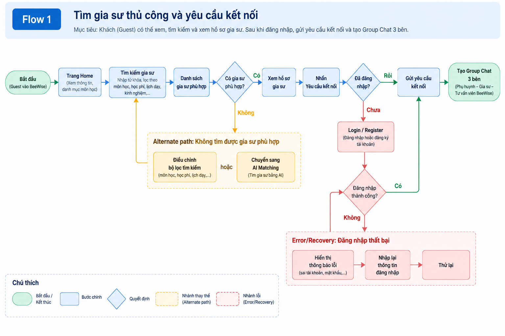

# User Flows

## Flow 1 - Tìm gia sư thủ công và yêu cầu kết nối

**Luồng chính:** Guest → Home → Search → Tutor Profile → Login → Connection Request → Group Chat.

**Alternate path:** Phụ huynh không tìm được gia sư phù hợp → điều chỉnh bộ lọc hoặc chuyển sang AI Matching.

**Error/Recovery:** Đăng nhập thất bại → hiển thị lỗi → nhập lại → tiếp tục yêu cầu kết nối, không mất hồ sơ gia sư đã chọn.

## Flow 2 - Tìm gia sư bằng AI (Free Trial)

**Luồng chính:** Guest → AI Matching → Free Trial → AI Results → Tutor Profile. Lần thứ hai yêu cầu đăng nhập.

**Alternate path:** Người dùng không hài lòng với kết quả AI → xem hồ sơ khác hoặc chuyển sang tìm kiếm thủ công.

**Error/Recovery:** AI không tìm được gia sư phù hợp hoặc xử lý thất bại → thông báo rõ nguyên nhân → cho điều chỉnh nhu cầu và thử lại. Nên quy định lượt AI chỉ bị trừ khi yêu cầu xử lý thành công.

## Flow 3 - Quy trình kết nối đến lịch học chính thức

**Luồng chính:** Group Chat → Học thử → Xác nhận thông tin lớp → Thanh toán → Xếp lịch chính thức.

### Các bước theo hình

- Bắt đầu trong Group Chat 3 bên: phụ huynh, gia sư và tư vấn viên.
- Tư vấn viên gửi widget Học thử; các bên trao đổi và thống nhất.
- Học thử hoàn tất; các bên trao đổi kết quả và nhu cầu tiếp tục.
- Tư vấn viên gửi widget Xác nhận lớp, gồm thông tin môn học, học phí và lịch dự kiến.
- Nếu thông tin lớp đã được xác nhận, hệ thống tự động gửi widget Thanh toán để phụ huynh thanh toán.
- Khi thanh toán thành công, hệ thống gửi widget Xếp lịch. Lịch học chính thức được xác lập và phụ huynh có thể xem lịch học.

**Alternate path - không tiếp tục sau buổi học thử:** Không hài lòng với kết quả học thử → trao đổi thêm với gia sư hoặc tư vấn viên → kết thúc quy trình hoặc tìm gia sư khác.

**Alternate path - yêu cầu điều chỉnh lớp:** Phụ huynh yêu cầu điều chỉnh thông tin môn học, học phí hoặc lịch học → tư vấn viên cập nhật và gửi lại widget Xác nhận lớp → quay lại bước xác nhận thông tin lớp.

**Error/Recovery - thanh toán thất bại:** Hiển thị thông báo lỗi → phụ huynh kiểm tra và thử lại hoặc chọn phương thức khác → quay lại widget Thanh toán.
